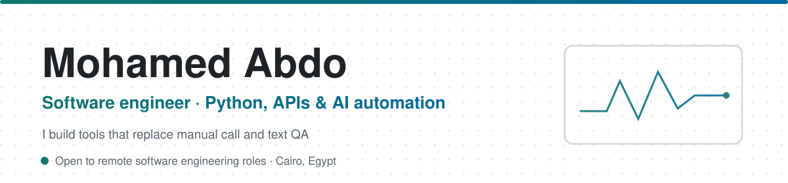
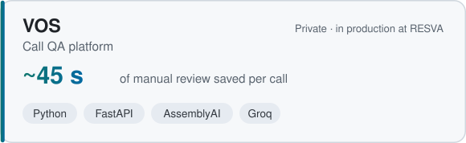
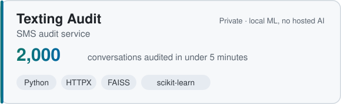
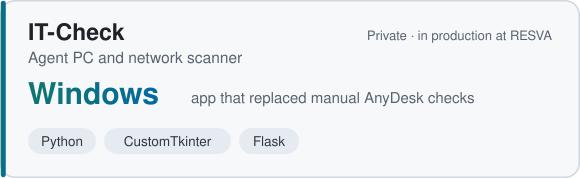
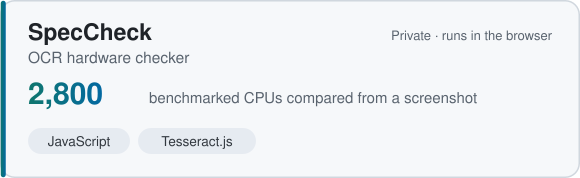
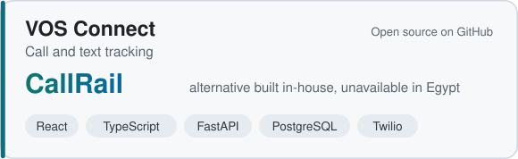
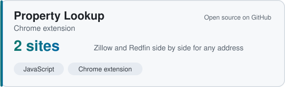
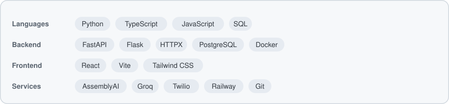

<picture>
  <source media="(prefers-color-scheme: dark)" srcset="assets/banner-dark.svg">
  
</picture>

I build automation that replaces manual call and text QA, mostly in Python, FastAPI and React. I have worked at RESVA for five years, the last one as a software engineer, and the tools below run there every day.

## Projects

<table>
  <tr>
    <td width="50%"><a href="https://vos-tool.up.railway.app/"><picture><source media="(prefers-color-scheme: dark)" srcset="assets/card-vos-dark.svg"></picture></a></td>
    <td width="50%"><picture><source media="(prefers-color-scheme: dark)" srcset="assets/card-texting-dark.svg"></picture></td>
  </tr>
  <tr>
    <td width="50%"><a href="https://vos-landing.vercel.app/"><picture><source media="(prefers-color-scheme: dark)" srcset="assets/card-itcheck-dark.svg"></picture></a></td>
    <td width="50%"><picture><source media="(prefers-color-scheme: dark)" srcset="assets/card-speccheck-dark.svg"></picture></td>
  </tr>
  <tr>
    <td width="50%"><a href="https://github.com/MOHAMEDVOS/VOS-connect"><picture><source media="(prefers-color-scheme: dark)" srcset="assets/card-vosconnect-dark.svg"></picture></a></td>
    <td width="50%"><a href="https://github.com/MOHAMEDVOS/Property-Lookup"><picture><source media="(prefers-color-scheme: dark)" srcset="assets/card-lookup-dark.svg"></picture></a></td>
  </tr>
</table>

The source for the first four is private because they run inside a company. VOS Connect and Property Lookup are open source.

What each one does

**VOS** pulls recordings from ReadyMode dialers, transcribes them with AssemblyAI, and checks whether the agent tried to keep the lead after a "no". A library of 2,000+ phrases and a semantic match settle about 80% of calls, and only the unclear ones go to a Groq LLM. It scores agents into the team's Google Sheet and creates up to 200 agent accounts across the dialers in under a minute, a job that took 1 to 2 hours by hand.

**Texting Audit Automation** reads SmarterContact conversations over REST and GraphQL with no browser, then flags compliance, attitude, professionalism and script mistakes with a local ML and rules pipeline. 20 parallel workers do the work, with no hosted AI calls and no per-conversation cost.

**IT-Check** tests an agent's PC, microphone and connection, reports to a Flask dashboard, and runs scheduled checks and updates.

**SpecCheck** reads a screenshot of a PC's specs with Tesseract.js OCR, compares the CPU against about 2,800 benchmarked chips and the RAM against the onboarding minimum, and runs in the browser with no backend.

**VOS Connect** assigns tracking numbers, routes incoming leads to clients, and shows response and conversion rates per campaign. **Property Lookup** shows the Zillow and Redfin price, beds, baths and links for an address.

## Stack

<picture>
  <source media="(prefers-color-scheme: dark)" srcset="assets/stack-dark.svg">
  
</picture>
